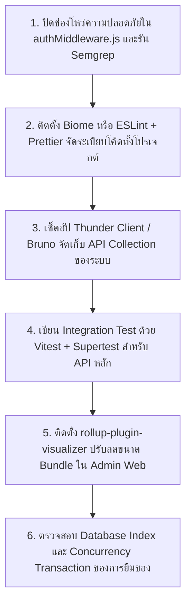

# 🛡️ คู่มือเครื่องมือและแนวทางการตรวจสอบโปรเจกต์ (Project Audit & Inspection Guide)
> **SUT Library Management System (ระบบจัดการยืม-คืนอุปกรณ์)**  
> รวบรวมแนวทางการตรวจสอบ 6 มิติหลัก พร้อมรายชื่อเครื่องมือ (CLI/Tools), Extensions สำหรับ IDE และข้อควรระวังเฉพาะของโปรเจกต์นี้

---

## 📌 สรุปโครงสร้างระบบปัจจุบัน (System Architecture)
- **Frontend:** React 19 + Vite + Tailwind CSS v4 (`my-library-user-web`, `my-library-admin-web`, `my-library-scanner`)
- **Backend:** Node.js (Express 5) + MySQL2 (Raw SQL Pool) + Socket.IO + JWT (`my-library-api-node`)
- **รูปแบบ:** Monorepo แยกแต่ละส่วนการทำงานอิสระ

---

## 1. ด้าน Quality (คุณภาพโค้ด & สถาปัตยกรรม)

เน้นตรวจจับ Code Smells, ความซับซ้อนของฟังก์ชัน (Cognitive Complexity), การจัด Format โค้ด และตรวจการ Import วนลูป

### 🛠️ เครื่องมือหลัก (CLI & Tools)
1. **Biome** *(แนะนำสำหรับ Monorepo)*
   - **หน้าที่:** All-in-one Linter + Formatter เขียนด้วย Rust รวดเร็วกว่า ESLint + Prettier 10–25 เท่า
   - **การติดตั้ง & รันคำสั่ง:**
     ```bash
     npm install --save-dev --save-exact @biomejs/biome
     npx @biomejs/biome init
     npx @biomejs/biome check --write .
     ```
2. **Prettier + prettier-plugin-tailwindcss** *(กรณีต้องการใช้ Prettier)*
   - **หน้าที่:** จัดเรียงลำดับคลาส Tailwind CSS v4 อัตโนมัติในคอมโพเนนต์ JSX
   - **คำสั่ง:** `npm install -D prettier prettier-plugin-tailwindcss`
3. **Madge**
   - **หน้าที่:** ตรวจสอบ Circular Dependency (การ import ไฟล์วนลูปข้ามไปมา)
   - **คำสั่ง:**
     ```bash
     npx madge --circular ./my-library-admin-web/src
     ```

### 🔌 Extensions สำหรับ IDE (VS Code / Antigravity)
- **SonarLint (`SonarSource.sonarlint-vscode`)**: แจ้งเตือน Code Smells, ฟังก์ชันที่ซับซ้อนเกินไป (Cyclomatic Complexity) แบบเรียลไทม์
- **Error Lens (`usernamehw.errorlens`)**: แสดง Error และ Warning ของ Linter บนบรรทัดโค้ดทันที
- **Tailwind CSS IntelliSense (`bradlc.vscode-tailwindcss`)**: ตรวจสอบและ Autocomplete คลาส Tailwind CSS

### 🔍 จุดสำคัญที่ต้องตรวจสอบในโปรเจกต์นี้
- ไฟล์ `my-library-api-node/routes/adminRoutes.js` มีความยาวกว่า **1,370 บรรทัด** ควรพิจารณา Refactor แยก Controller/Service ออกเป็นโมดูลย่อย

---

## 2. ด้าน Security (ความปลอดภัย)

เน้นค้นหาช่องโหว่ความปลอดภัยระดับโค้ด (SAST), ข้อมูลสำคัญรั่วไหล (Secrets Leak) และความเสี่ยงของ Dependencies (SCA)

### 🛠️ เครื่องมือหลัก (CLI & Tools)
1. **Semgrep (SAST)**
   - **หน้าที่:** สแกนหาช่องโหว่ตามมาตรฐาน **OWASP Top 10** เช่น SQL Injection, Broken Access Control
   - **คำสั่ง:**
     ```bash
     npx semgrep --config auto
     ```
2. **TruffleHog / GitGuardian CLI**
   - **หน้าที่:** ตรวจสอบประวัติ Git ย้อนหลังทั้งหมดว่ามีการเผลอ Commit Credential/Secrets หรือไม่ (เช่น SMTP App Password, Database Password)
   - **คำสั่ง:**
     ```bash
     npx trufflehog git file://. --only-verified
     ```
3. **npm audit & Snyk**
   - **หน้าที่:** ตรวจสอบความเสี่ยงของแพ็กเกจ npm
   - **คำสั่ง:**
     ```bash
     npm audit
     npx snyk test
     ```
4. **Middlewares ความปลอดภัยที่ควรติดตั้งเพิ่มใน API (`my-library-api-node`):**
   - `helmet`: ตั้งค่า HTTP Security Headers
   - `express-rate-limit`: ป้องกันการยิง Brute-force Login หรือการสแปมจองคิวยืมของ

### 🔌 Extensions สำหรับ IDE
- **Snyk Security (`snyk-security.snyk-vulnerability-scanner`)**: แสดงช่องโหว่ของ Dependencies และแนะนำวิธีอัปเดตเวอร์ชันที่ปลอดภัย

### 🔍 จุดสำคัญที่ต้องตรวจสอบในโปรเจกต์นี้
- **Authentication Bypass ใน `my-library-api-node/middleware/authMiddleware.js`:**
  - มีโค้ด Fallback รับ `req.query.id` / `req.body.id` เมื่อ Token ไม่มีหรือไม่ถูกต้อง ซึ่งเปิดช่องให้ผู้ไม่หวังดีส่ง `?id=admin` เพื่อข้ามการยืนยันตัวตนได้ ต้องปิดช่องโหว่นี้ทันที
- **Fallback Secret Key:** หลีกเลี่ยงการใช้ค่าเริ่มต้น `JWT_SECRET || 'project-libraries-secret-key-2026'` ในสภาพแวดล้อมจริง

---

## 3. ด้าน Performance (ประสิทธิภาพ)

เน้นการควบคุมขนาด Bundle ฝั่งหน้าเว็บ, การจัดการ Re-render, ประสิทธิภาพ API และ WebSocket Real-time

### 🛠️ เครื่องมือหลัก (CLI & Tools)
1. **rollup-plugin-visualizer (สำหรับ Vite)**
   - **หน้าที่:** แสดง Treemap แผนภาพขนาดของไฟล์ Bundle
   - **การติดตั้งใน Vite Projects (`my-library-admin-web` / `my-library-user-web`):**
     ```bash
     npm install -D rollup-plugin-visualizer
     ```
   - *ประโยชน์:* ตรวจสอบว่าไลบรารีขนาดใหญ่ เช่น `jspdf`, `xlsx`, `html2canvas`, `recharts` ควรทำ **Code Splitting (Dynamic Import)** หรือไม่
2. **Autocannon / k6 (Backend Load Testing)**
   - **หน้าที่:** ยิงทดสอบ Request per second (RPS) และ Latency ของ API
   - **คำสั่ง:**
     ```bash
     npx autocannon -c 100 -d 10 http://localhost:5000/api/admin/equipment_items/status
     ```
3. **Artillery (Socket.IO Stress Testing)**
   - **หน้าที่:** จำลอง Client ต่อฟัง Event ผ่าน WebSockets พร้อมกันจำนวนมาก เพื่อดูว่า Event Loop หน่วงหรือไม่
4. **Clinic.js (Node.js Diagnostics)**
   - **หน้าที่:** วิเคราะห์ CPU Spike, Event Loop Lag, และ Memory Leak ใน Express API
   - **คำสั่ง:**
     ```bash
     npx clinic doctor -- node server.js
     ```

### 🔌 Extensions & DevTools
- **Chrome DevTools (Lighthouse & Performance Tab):** ตรวจสอบคะแนน Web Vitals (LCP, INP, CLS)
- **React Developer Tools (Profiler):** ตรวจจับการ Re-render ถี่เกินความจำเป็นเมื่อมี Socket.IO อัปเดตข้อมูล

---

## 4. ด้าน Testing (การทดสอบระบบ)

เพิ่มความมั่นใจในการทำงานของระบบยืม-คืนด้วยการทดสอบแบบครอบคลุม (ปัจจุบันยังไม่มีชุดทดสอบใน `npm test`)

### 🛠️ เครื่องมือหลัก (CLI & Libraries)
1. **Vitest + React Testing Library (Unit & Component Test)**
   - **หน้าที่:** ทดสอบ Logic ภายในคอมโพเนนต์และการคำนวณวันคืน/ค่าปรับ ทำงานร่วมกับ Vite ได้รวดเร็ว
   - **คำสั่ง:**
     ```bash
     npm install -D vitest @testing-library/react @testing-library/jest-dom
     ```
2. **Supertest (API Integration Test)**
   - **หน้าที่:** ยิงทดสอบ Route ของ Express 5 โดยไม่ต้องสตาร์ตพอร์ตจริง
   - **เคสตัวอย่างที่ควรเทส:**
     - ยิงเข้า Route Admin โดยไม่มี Token ต้องได้ HTTP `401 Unauthorized`
     - ข้อมูลยืมอุปกรณ์ไม่ครบถ้วน ต้องถูกตรวจจับด้วย Zod Schema
3. **Playwright (End-to-End Test)**
   - **หน้าที่:** จำลองการใช้งานจริงผ่านเบราว์เซอร์อัตโนมัติ
   - **Flow สำคัญ:** User เลือกของลงตะกร้า -> ยืนยันการยืม -> Admin ได้รับแจ้งเตือน Real-time -> Admin กดอนุมัติรับของ

### 🔌 Extensions สำหรับ IDE
- **Playwright Test for VSCode (`ms-playwright.playwright`)**: รันและ Record การกระทำบนหน้าจอเป็นโค้ดเทส
- **Vitest Explorer (`ZixuanChen.vitest-explorer`)**: แสดงสถานะเทสเคสทั้งหมดพร้อมปุ่ม Run/Debug

---

## 5. ด้าน API Management & Documentation (การจัดการและเอกสาร API)

รวบรวม Endpoint ของระบบให้เป็นระเบียบและทดสอบได้สะดวก

### 🛠️ เครื่องมือหลัก (CLI & Tools)
1. **Bruno** *(แนะนำสำหรับทีมพัฒนา)*
   - **หน้าที่:** API Client ทางเลือกของ Postman ที่เป็น **Open-source & Git-friendly**
   - **จุดเด่น:** บันทึก Collection เป็นไฟล์ข้อความ `.bru` เก็บลงในโฟลเดอร์โปรเจกต์และ Commit ขึ้น Git ร่วมกันได้ ไม่ต้องซิงก์ Cloud
2. **Swagger UI Express (`swagger-ui-express` + `swagger-jsdoc`)**
   - **หน้าที่:** สร้างหน้า Web Document อัตโนมัติที่ `http://localhost:5000/api-docs` เพื่อให้ฝั่ง Frontend/Mobile ดู Request/Response Schema ได้ง่าย

### 🔌 Extensions สำหรับ IDE
- **Thunder Client (`rangav.vscode-thunder-client`)**: ยิงทดสอบ REST API ภายในตัว IDE ได้ทันที พร้อมระบบจัดการ Environment Variables (เช่น จัดเก็บ JWT Token)
- **OpenAPI (Swagger) Editor (`42Crunch.vscode-openapi`)**: ช่วยเขียนและตรวจสอบโครงสร้างไฟล์ OpenAPI/Swagger

---

## 6. ด้าน Database & Data Integrity (ฐานข้อมูลและความสมบูรณ์ของข้อมูล)

ป้องกันปัญหาข้อมูลสต็อกไม่ตรงกัน, ป้องกัน Race Condition และเพิ่มความเร็วในการ Query

### 🛠️ เครื่องมือหลัก (CLI & Tools)
1. **Database Migration Tool (Knex.js หรือ Drizzle ORM)**
   - **หน้าที่:** แทนที่การรันไฟล์ `.sql` แบบเดิมด้วยระบบ Version Control ของฐานข้อมูล เพื่อความแม่นยำเวลา Deploy
2. **MySQL EXPLAIN / EXPLAIN ANALYZE**
   - **หน้าที่:** วิเคราะห์ประสิทธิภาพของ Query ตาราง `borrowed`, `equipment_items` ว่ามีการใช้ Index หรือไม่
3. **Database Transactions (InnoDB Locking)**
   - **จุดที่ต้องตรวจสอบในโค้ด:** จังหวะที่มีการยืมของชิ้นสุดท้าย ต้องใช้ `START TRANSACTION` ร่วมกับ `SELECT ... FOR UPDATE` เพื่อป้องกันไม่ให้อุปกรณ์ถูกยืมซ้อนพร้อมกัน 2 คน (Race Condition)

### 🔌 Extensions สำหรับ IDE
- **Database Client (`cweijan.vscode-database-client2`)**: เชื่อมต่อ MySQL, ดูตาราง, รัน SQL, และดูแผนภาพ ER Diagram ได้จากใน IDE
- **SQLTools (`mtxr.sqltools`)**: ตัวจัดการฐานข้อมูลน้ำหนักเบา

---

## 🗺️ สรุปแผนปฏิบัติการตามลำดับความสำคัญ (Roadmap)



---

## 📋 เช็คลิสต์ Extension แนะนำให้ติดตั้งใน VS Code / Antigravity

| Extension ID | ชื่อ Extension | หน้าที่หลัก |
| :--- | :--- | :--- |
| `SonarSource.sonarlint-vscode` | **SonarLint** | ตรวจจับ Clean Code & Code Smells เรียลไทม์ |
| `snyk-security.snyk-vulnerability-scanner` | **Snyk Security** | ตรวจสอบช่องโหว่ความปลอดภัยระดับโค้ดและไลบรารี |
| `bradlc.vscode-tailwindcss` | **Tailwind CSS IntelliSense** | แนะนำคลาสและตรวจจับความถูกต้องของ Tailwind v4 |
| `rangav.vscode-thunder-client` | **Thunder Client** | ยิงและจัดการเทส REST API ได้จากใน IDE |
| `cweijan.vscode-database-client2` | **Database Client** | เชื่อมต่อและจัดการฐานข้อมูล MySQL ในหน้าต่างเดียว |
| `usernamehw.errorlens` | **Error Lens** | ไฮไลต์ข้อผิดพลาดและคำเตือนบนบรรทัดโค้ดทันที |
| `ms-playwright.playwright` | **Playwright Test** | จัดการและรันชุดทดสอบ E2E อัตโนมัติ |

